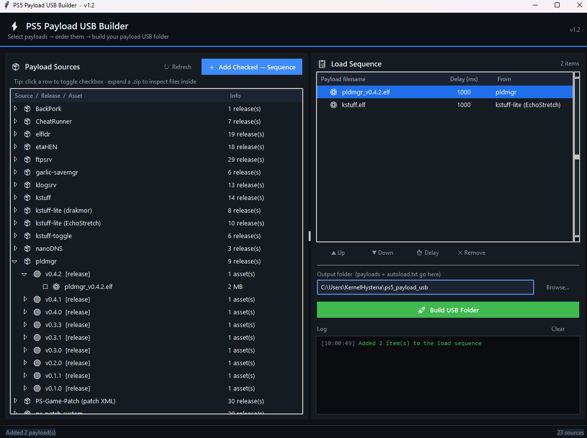

# PS5 Payload USB Builder

Desktop GUI to pick PS5 payloads from GitHub/Gitea releases, order them with delays, and export a folder containing the files plus an `autoload.txt` for payload managers that support it.



## Features

- Browse sources → releases → assets (expand zips to pick individual `.elf` files)
- Checkbox select + ordered load sequence with per-payload delays
- One-click **Build USB Folder** → downloads everything + writes `autoload.txt`
- Sources live in `sources.json` (edit anytime, no code changes)
- Pure Python stdlib — no pip installs needed

## Quick start

```bash
# needs Python 3.8+ with tkinter
python ps5_payload_usb_builder.py
```

1. Hit **↻ Refresh** to load releases  
2. Check the payloads you want → **＋ Add Checked → Sequence**  
3. Reorder / set delays as needed  
4. Choose output folder → **🚀 Build USB Folder**  
5. Copy the folder contents to your USB (or wherever your payload manager looks)

## sources.json

Sit this file next to the `.py` (or `.exe`). Add/remove repos like:

```json
{
  "name": "my-payload",
  "type": "github",
  "owner": "SomeUser",
  "repo": "some-repo"
}
```

Gitea example:

```json
{
  "name": "garlic-savemgr",
  "type": "gitea",
  "base": "https://git.etawen.dev",
  "owner": "earthonion",
  "repo": "garlic-savemgr"
}
```

Optional: `"tags_fallback": true` if the repo has no formal releases.


## Building an .exe (optional)

```bash
pip install pyinstaller
pyinstaller --noconfirm --windowed --name "PS5 Payload USB Builder" ^
  --add-data "sources.json;." ps5_payload_usb_builder.py
```

Put `sources.json` beside the exe (or it uses the bundled copy). You can still edit it later without rebuilding.
